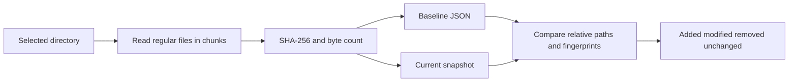

# File Integrity Checker

A lightweight Python command-line tool that compares file contents against a saved SHA-256 baseline. It reports added, modified and removed files without changing the scanned files.

Useful for reviewing configuration drift or checking a directory after maintenance. A change report identifies differences; it does not determine whether a change is authorized or malicious.

## Quick start

Requires Python 3.12+; locally tested on Windows with Python 3.14.2. No third-party packages, administrator privileges, VM or cloud account are required. Run commands from this repository folder.

```text
python integrity.py baseline samples baseline.json
python integrity.py check samples baseline.json
```

The first command creates a baseline for the two fictional sample files. The second should print:

```json
{
  "added": [],
  "modified": [],
  "removed": [],
  "unchanged_count": 2
}
```

Edit a line in `samples/settings.txt`, save it, and run only the second command again. `modified` should contain `settings.txt`. An existing baseline is never overwritten automatically. Preserve the original baseline until the differences have been reviewed; create a new file such as `baseline-reviewed.json` when accepting a new state.

On systems where Python is named `python3`, use that command instead. Baseline files are ignored by Git and must be stored outside the scanned directory.

## How it works



The tool scans recursively, including hidden files. It uses relative paths so the baseline does not contain an absolute user directory. File contents are read locally and never uploaded. Empty files are hashed; empty directories are not tracked. A rename appears as a removed path plus an added path. Changing only a timestamp does not count as a content change.

## Baseline format

```json
{
  "version": 1,
  "algorithm": "sha256",
  "files": {
    "example.txt": {
      "sha256": "ba7816bf8f01cfea414140de5dae2223b00361a396177a9cb410ff61f20015ad",
      "size": 3
    }
  }
}
```

This fingerprint is for the three bytes `abc`. Baseline parsing rejects duplicate JSON keys, unsupported schema versions/algorithms, malformed hashes, negative sizes and unsafe relative paths. A baseline cannot be inside the scanned directory, which would make it part of its own comparison.

## Exit codes

| Code | Meaning |
| --- | --- |
| 0 | Baseline created, or check found no differences |
| 1 | Check completed and found differences |
| 2 | Invalid input, unreadable file, unsupported object or other scan error |

Exit 1 is an intentional result, not a crash. Failed reads stop the scan with an error; the program does not silently report a partial scan as clean. The manifest's parent directory must already exist.

## Validation

```text
python -m unittest discover -s tests -v
```

For a fully automated demonstration:

```text
python demo.py
```

The demonstration creates temporary copies of the fictional samples, checks seven CLI scenarios and removes only its temporary directory afterward. It verifies unchanged, modified, added, removed and renamed files, baseline overwrite prevention, and invalid baseline handling. The original samples and existing baseline are preserved. The [recorded demonstration results](docs/demo-results.json) show all seven scenarios passing.

Local verification on 2026-11-10: 15 tests discovered, 14 passed and 1 skipped because symbolic-link creation was not permitted for the Windows account. Tests cover known hash values, same-size edits, all change categories, renames, nested/hidden/empty files, timestamp-only changes, baseline validation, read errors, exit codes and overwrite prevention. See [verification](docs/verification.md).

Published at [husseinabdulkader/file-integrity-checker](https://github.com/husseinabdulkader/file-integrity-checker). [GitHub Actions passed](https://github.com/husseinabdulkader/file-integrity-checker/actions/runs/42767541989) on Windows and Ubuntu with Python 3.14, including the test suite and all seven demonstration scenarios.

## Scope and limitations

- This is an on-demand content checker, not a continuous monitoring service or malware detector.
- SHA-256 is available through Python's standard `hashlib` library. Hashing does not encrypt files or establish authorization. [Python hashlib documentation](https://docs.python.org/3.14/library/hashlib.html)
- The baseline is unsigned. Anyone able to alter both files and baseline can conceal changes. Protect the baseline separately; this first version does not implement signing, protected storage or access control.
- Links and Windows reparse points are rejected. The scan must target ordinary local directories; it is not designed for synchronized placeholders or virtual filesystems.
- File metadata checks detect some concurrent edits, but the scan is not an atomic filesystem snapshot or hardened against deliberate path races. Use an idle directory. Files created after directory enumeration can be missed.
- Permissions, ownership, Windows alternate data streams and directory metadata are not compared. Hard-link relationships are not recorded.
- The baseline is portable and is not bound to a machine or root path. Supply the intended directory when checking it. Filenames and hashes may still reveal sensitive information; keep real baselines private.
- Memory use grows with file count; contents are hashed in chunks. Large trees take time and disk I/O even though no VM is required.

Filesystem operations use the standard [pathlib API](https://docs.python.org/3.14/library/pathlib.html). Documentation reviewed 2026-11-10.

## Troubleshooting and cleanup

If baseline creation says the file already exists, reuse it for `check` or choose a new baseline filename after reviewing changes. If a file is inaccessible or changing during the scan, close the relevant application or choose a stable test directory and rerun. Do not interpret an error as no differences.

The sample files are fictional. Restore sample edits through version control or a saved copy when finished. Delete only locally created baseline/report files that are no longer needed. The utility installs no service, schedules no task and changes no system configuration.

## Roadmap

Implemented: baseline creation, comparison, strict input validation, local automated tests and a reproducible CLI demonstration. Possible later extensions: report export, explicitly scoped exclusions and protected baseline storage. These extensions are not implemented.
